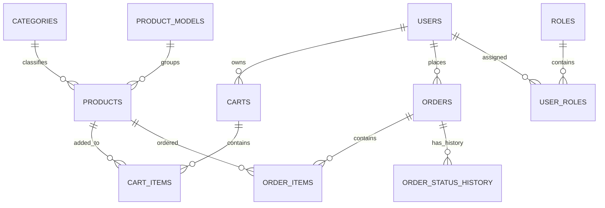

# ER Diagram – OnlineShop

## 1. Các thực thể

- Users: Thông tin tài khoản người dùng.
- Roles: Danh sách vai trò.
- User_Roles: Liên kết người dùng với vai trò.
- Categories: Danh mục sản phẩm.
- Product_Models: Nhóm sản phẩm.
- Products: Thông tin sản phẩm và biến thể.
- Carts: Giỏ hàng của người dùng.
- Cart_Items: Chi tiết sản phẩm trong giỏ.
- Orders: Đơn hàng.
- Order_Items: Chi tiết sản phẩm trong đơn hàng.
- Order_Status_History: Lịch sử thay đổi trạng thái đơn hàng.

## 2. ER Diagram

## 3. Ghi chú

- Một người dùng có tối đa một giỏ hàng.
- Một người dùng có thể tạo nhiều đơn hàng.
- Một đơn hàng có nhiều chi tiết đơn hàng.
- Một sản phẩm có thể xuất hiện trong nhiều giỏ hàng và đơn hàng.
- Products có khóa ngoại đến Categories và Product_Models.
- Product_Models.category_id hiện chưa có khóa ngoại trong CSDL.
- User.java hiện sử dụng users.role; chưa ánh xạ hai bảng roles và user_roles.
- Một đơn hàng có thể có nhiều bản ghi lịch sử thay đổi trạng thái.
- Order_Status_History lưu trạng thái cũ, trạng thái mới và thời điểm thay đổi.